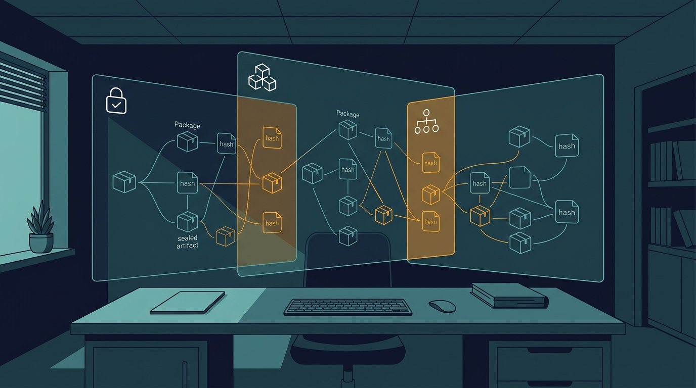

Un proveedor entrega una aplicación, un SBOM impecable y una declaración tranquilizadora: «todos los componentes están inventariados». El documento tiene nombres, versiones, licencias y relaciones; incluso pasa la validación de esquema. **Pero un inventario bien formado no demuestra por sí solo que describa el fichero recibido, que esté completo ni que sus componentes estén realmente presentes.** Para una investigación OSINT responsable, la pregunta útil no es si existe un SBOM, sino qué vínculo verificable mantiene con el artefacto exacto que vamos a evaluar.



**Descargar el podcast!**: [Descargar el podcast](/podcasts/sbom-artefacto-real-osint.m4a)


*Imagen generada mediante inteligencia artificial.*

<!-- truncate -->

Este artículo propone un flujo defensivo para contrastar un **Software Bill of Materials** con software público, propio o recibido dentro de una revisión autorizada. El ejemplo es ficticio y no requiere explotar servicios, ejecutar código desconocido ni investigar a personas. Su objetivo es convertir un documento de transparencia en evidencia trazable, conservando también los huecos y desacuerdos.

## Qué es un SBOM y para qué sirve

Un SBOM es un inventario estructurado de componentes de software y de datos asociados a ellos. Puede incluir nombres, versiones, proveedores, identificadores persistentes, hashes, licencias y relaciones de dependencia. Formatos como [SPDX](https://spdx.dev/use/specifications/) y [CycloneDX](https://cyclonedx.org/capabilities/sbom/) permiten intercambiar esa información entre productores, clientes y herramientas.

En OSINT y debida diligencia técnica, un SBOM ayuda a:

- localizar qué componente merece una comprobación adicional;
- relacionar un aviso público con una versión declarada;
- comparar entregas y observar altas, bajas o cambios inesperados;
- revisar licencias y procedencia sin empezar desde una lista en blanco;
- documentar qué sabía el proveedor y qué observó el analista en una fecha concreta.

No es una certificación de seguridad, una prueba de ausencia de vulnerabilidades ni una garantía de integridad. Tampoco todos los SBOM describen el mismo objeto: uno puede representar el código fuente, otro el entorno de construcción y otro la imagen o el paquete distribuido. Antes de comparar hay que identificar **sujeto, momento y método de generación**.

### Cuatro afirmaciones que conviene mantener separadas

| Afirmación | Evidencia mínima útil | Lo que todavía no demuestra |
| --- | --- | --- |
| El documento es válido | validación contra el esquema declarado | que el contenido sea exacto |
| El SBOM corresponde a la entrega | digest o referencia inequívoca del artefacto | que enumere todo su contenido |
| Un componente fue observado | fichero, metadato o señal reproducible dentro del artefacto | que se cargue o ejecute |
| El proveedor declaró un componente | entrada y relación dentro del SBOM entregado | que el componente esté presente |

Esta separación evita el error más frecuente: convertir «el JSON se puede leer» en «el inventario está verificado».

## Caso de uso legítimo: una entrega con dos inventarios

La cooperativa ficticia **Archivo Norte** evalúa, con autorización, una utilidad de escritorio llamada `faro-documental-4.2.0.zip`. El proveedor entrega además `faro-documental.cdx.json`. La finalidad no es buscar fallos explotables, sino responder a tres preguntas antes de incorporar el programa:

1. ¿El SBOM identifica el mismo artefacto que recibió el equipo?
2. ¿Qué componentes aparecen tanto en el inventario declarado como en una observación independiente?
3. ¿Qué discrepancias necesitan explicación o una nueva evidencia?

El equipo trabaja sobre una copia aislada y no ejecuta el binario. Genera un segundo inventario con una herramienta capaz de inspeccionar archivos locales. Los nombres del ejemplo, hashes y resultados son ficticios.

El SBOM del proveedor declara 143 componentes. La observación independiente encuentra 139. Tras normalizar identificadores, 134 coinciden, nueve solo aparecen en el documento declarado y cinco solo en el observado. **Eso no permite afirmar que falten nueve ni que sobren cinco.** Abre una cola de revisión: puede haber dependencias de compilación, paquetes incorporados estáticamente, archivos minimizados, alias, versiones inferidas o límites distintos entre herramientas.

## Flujo recomendado paso a paso

### 1. Fija el objeto antes de abrir el inventario

Conserva el fichero original en almacenamiento de solo lectura o en una ubicación controlada. Registra origen, fecha, tamaño y un digest criptográfico:

```bash
sha256sum faro-documental-4.2.0.zip
```

No renombres entregas distintas como si fueran la misma versión. Si el proveedor publica un hash, registra de dónde procede y compáralo, pero no lo conviertas automáticamente en una fuente independiente: fichero y hash pueden venir del mismo canal comprometido.

### 2. Identifica el sujeto del SBOM declarado

Revisa el formato, la herramienta creadora, la fecha y el componente raíz. Busca un hash, nombre de fichero, URI o identificador que permita vincular el documento con la entrega. Si solo dice «versión 4.2.0», la correspondencia sigue siendo una hipótesis: pueden existir recompilaciones distintas bajo la misma etiqueta.

Formula el resultado con estados explícitos:

- **vinculado**, cuando el SBOM identifica de forma verificable el artefacto fijado;
- **compatible**, cuando nombre y versión encajan pero falta un vínculo fuerte;
- **contradictorio**, cuando el documento apunta a otro objeto;
- **inconcluso**, cuando los datos no bastan.

### 3. Valida estructura sin confundirla con contenido

Usa el validador oficial o una implementación mantenida para el formato declarado. [CycloneDX CLI](https://github.com/CycloneDX/cyclonedx-cli) permite validar documentos CycloneDX, mientras que SPDX publica sus especificaciones y modelos oficiales. Guarda la salida, la herramienta y su versión.

Una validación correcta prueba que el documento satisface determinadas reglas sintácticas y semánticas del formato. No prueba que un nombre, una versión o una relación describan la realidad. Un SBOM puede ser perfectamente válido y pertenecer a otra compilación.

### 4. Genera una observación independiente y reproducible

Inspecciona el artefacto sin ejecutarlo. [Syft](https://github.com/anchore/syft) documenta la generación de SBOM en CycloneDX y SPDX y permite escribir ambos formatos en una misma ejecución. La forma general es:

```bash
unzip -q faro-documental-4.2.0.zip -d ./faro-documental-extraido
syft ./faro-documental-extraido \
  -o spdx-json=./observado.spdx.json \
  -o cyclonedx-json=./observado.cdx.json
```

La extracción y el directorio deben permanecer vinculados al digest del ZIP original dentro del registro del caso. Comprueba la documentación de la herramienta instalada antes de automatizar el comando. Ejecuta el análisis en un entorno aislado, sin credenciales y sin red si el caso lo permite. Conserva configuración, catálogo de analizadores y advertencias: cambiar esos parámetros puede cambiar la cobertura.

El inventario observado tampoco es la verdad completa. Los gestores de paquetes dejan metadatos distintos, algunos binarios eliminan símbolos, el enlazado estático oculta fronteras y los paquetes anidados pueden no detectarse. Por eso se trata como **otra observación con límites**, no como oráculo.

### 5. Normaliza antes de comparar

No unas componentes solo por cadenas parecidas. Mantén los valores originales y crea una vista de comparación con, por ejemplo:

- `purl` completo cuando exista;
- ecosistema, nombre y versión normalizados;
- hash del fichero o componente, si ambos lados lo proporcionan;
- identificador SPDX, CPE u otro identificador con su tipo explícito;
- relación con el componente raíz;
- alcance: ejecución, desarrollo, compilación, opcional o desconocido.

Trata un alias como una regla versionada y revisable, no como una sustitución silenciosa. `lib-ejemplo`, `lib_ejemplo` y `@archivo/lib-ejemplo` podrían ser el mismo proyecto, tres paquetes distintos o una bifurcación. La similitud léxica no resuelve identidad.

### 6. Reconcila por clases, no con una cifra única

Construye al menos cuatro conjuntos:

1. **coincidencias fuertes:** mismo identificador y versión, idealmente con hash compatible;
2. **coincidencias probables:** equivalencia razonable que aún necesita corroboración;
3. **solo declarado:** posibles dependencias de construcción, opcionales o ausentes;
4. **solo observado:** posibles omisiones, componentes empaquetados o falsos positivos.

Añade una quinta clase para conflictos: mismo identificador con versiones o hashes incompatibles. No ocultes estos casos dentro de un porcentaje de cobertura. Una coincidencia del 97 % puede esconder precisamente el componente que determina la decisión.

### 7. Revisa discrepancias con evidencia mínima

Para cada diferencia prioritaria, conserva:

- entrada original de ambos SBOM;
- ruta o señal que motivó la detección;
- digest del artefacto analizado;
- regla de normalización aplicada;
- hipótesis alternativas;
- prueba siguiente y responsable;
- estado final: confirmado, descartado o inconcluso.

Antes de concluir una omisión, consulta manifiestos del paquete, ficheros de licencia, metadatos del gestor y documentación pública del proyecto. Si la consecuencia es relevante, pide al proveedor el SBOM generado en la fase de entrega o una atestación que vincule inventario y artefacto. Una explicación es una nueva fuente que también debe evaluarse.

### 8. Informa con alcance y caducidad

El informe debe decir qué artefacto se examinó, qué no se ejecutó, qué herramientas se usaron y qué clases de componentes pueden quedar fuera. Distingue observaciones de inferencias:

> «La herramienta X detectó metadatos compatibles con el paquete Y»

es más preciso que:

> «La aplicación usa Y».

Fija una condición de reevaluación: nuevo digest, reconstrucción, cambio del SBOM, actualización del analizador o aparición de evidencia primaria.

## Limitaciones y falsos positivos

### Diferencias de alcance

Un SBOM creado desde el repositorio puede incluir dependencias de pruebas y excluir archivos generados. Uno creado desde una imagen puede observar bibliotecas del sistema que el proyecto no controla directamente. Compararlos sin modelar el alcance produce discrepancias artificiales.

### Dependencias estáticas y código vendorizado

Una biblioteca integrada dentro de un binario puede perder metadatos reconocibles. El código copiado en el repositorio puede aparecer como archivos, no como paquete. La ausencia de detección no demuestra ausencia material.

### Versiones inferidas

Algunas herramientas deducen versiones desde nombres, manifiestos o patrones. Un fichero residual puede señalar una versión que no se usa. Registra la técnica de identificación y rebaja la confianza cuando no exista hash o metadato inequívoco.

### Relaciones incompletas

Que dos componentes estén listados no significa que la relación entre ellos sea correcta. Un inventario plano sirve para búsqueda, pero no necesariamente para reconstruir qué componente depende de cuál ni qué parte llega al producto final.

### Mutabilidad de fuentes externas

Avisos, registros de paquetes y repositorios cambian. Conserva URL, fecha y copia permitida de la evidencia decisiva. No uses una búsqueda actual para atribuir retrospectivamente una propiedad sin comprobar la cronología.

## Buenas prácticas de OPSEC, ética y privacidad

- Analiza únicamente software público, propio o autorizado; no uses este flujo para acceder a sistemas ajenos.
- No ejecutes un artefacto desconocido para «ver qué carga» salvo en un laboratorio autorizado y diseñado para ello.
- Separa el entorno de análisis de credenciales, tokens, llaves y datos reales.
- Desactiva telemetría y red cuando sea compatible con la herramienta y documenta las excepciones.
- Minimiza nombres, correos y rutas personales que puedan aparecer en metadatos de compilación.
- No publiques rutas internas, secretos o detalles de una exposición sin coordinar una divulgación responsable.
- Evita atribuir intención a partir de una omisión: un SBOM incompleto puede deberse a alcance, herramienta o proceso, no a engaño.
- Respeta licencias y condiciones de redistribución del artefacto y de sus metadatos.

## Checklist operativo

- [ ] El artefacto está fijado por digest, origen y fecha.
- [ ] El sujeto y el alcance del SBOM declarado están identificados.
- [ ] La validación de formato se registra por separado de la exactitud.
- [ ] La observación independiente no ejecuta código innecesariamente.
- [ ] Herramienta, versión, configuración y advertencias quedan conservadas.
- [ ] La normalización mantiene los valores originales.
- [ ] Coincidencias, conflictos y ausencias se presentan como clases distintas.
- [ ] Cada discrepancia relevante conserva evidencia y explicación alternativa.
- [ ] Las conclusiones distinguen presencia, uso y carga en ejecución.
- [ ] El informe incluye límites, privacidad y condición de reevaluación.

## Alternativas y siguientes pasos

Un segundo generador de SBOM puede revelar puntos ciegos, pero dos herramientas que comparten analizadores o metadatos no son independientes por definición. Para entregas críticas, combina inventario con firmas, procedencia de compilación, manifiestos del ecosistema, revisión de archivos y evidencia del proceso de publicación.

SPDX y CycloneDX no son «ganador y perdedor»: ambos pueden transportar inventarios útiles y cada ecosistema añade capacidades y perfiles diferentes. Elige el formato por interoperabilidad, información necesaria y herramientas disponibles, y conserva la semántica al convertir entre ellos. Una conversión válida puede perder campos que el destino no expresa del mismo modo.

El takeaway práctico es este: **un SBOM merece confianza proporcional al vínculo con su artefacto, la transparencia de su generación y la corroboración de sus componentes, no a lo ordenado que parezca el JSON**. Como siguiente tema, sería útil estudiar VEX para entender cuándo una vulnerabilidad conocida afecta realmente a un producto sin convertir una declaración del proveedor en veredicto automático.

## Fuentes oficiales consultadas

- [SPDX: especificaciones oficiales](https://spdx.dev/use/specifications/)
- [CycloneDX: capacidad SBOM](https://cyclonedx.org/capabilities/sbom/)
- [CycloneDX: visión general de la especificación](https://cyclonedx.org/specification/overview/)
- [Syft: repositorio y uso oficial](https://github.com/anchore/syft)
- [CycloneDX CLI: validación y operaciones con BOM](https://github.com/CycloneDX/cyclonedx-cli)

